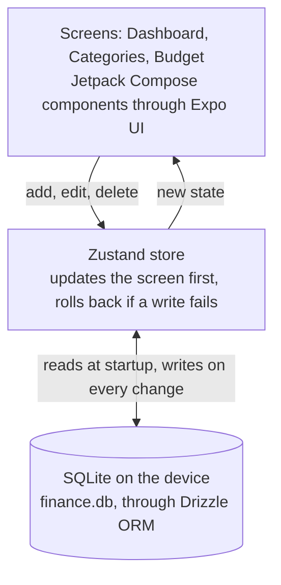

<p align="center"></p>

# Budgi

An offline-first personal finance app for Android. Track income and expenses by category, set a budget for each month and for each category, and watch the budget bars go from green to red as you spend. Everything stays on your phone: no account, no network, no tracking.

**[Get Budgi on Google Play](https://play.google.com/store/apps/details?id=com.sobashy.Budgi)**

## Features

- **Transactions:** income and expenses, each with a category, a date and an optional note.
- **Monthly summary:** the dashboard shows the month's income, expenses and balance.
- **Categories:** each has its own icon and color. A category that has transactions can't be deleted by accident.
- **Budgets:** a total budget for each month, plus a budget for each category. One tap copies last month's budgets into a new month.
- **Budget bars:** they change color at 20%, 40%, 60% and 80% of the budget, from green to red.
- **History:** a month selector to move between months.
- **Private by design:** all data lives in a SQLite database on the device. See the [privacy policy](docs/privacy-policy.md).

## How it's built

- **App:** React Native 0.85 and Expo SDK 56, in TypeScript. Expo Router handles navigation with typed routes, and the React Compiler is on.
- **Native Android UI:** screens are built from Jetpack Compose components through [Expo UI](https://docs.expo.dev/versions/v56.0.0/sdk/ui/) (`@expo/ui/jetpack-compose`). Dialogs, buttons and sheets are real Material components, not JavaScript imitations. A config plugin, `plugins/withMaterialSymbols.js`, copies the Material Symbols icons the app uses into the Android project as native drawables.
- **Data:** SQLite on the device through `expo-sqlite` and Drizzle ORM. drizzle-kit generates the SQL migrations, and the app applies them at startup, behind the splash screen, before the first screen appears. A fresh install gets two starter categories.
- **Money:** amounts are stored as whole cents, so totals never pick up floating-point errors.
- **State:** a Zustand store loads everything from SQLite once at startup. Every change updates the screen first, then writes to SQLite, and rolls the screen back if the write fails.



### Data model

| Table              | What it holds                                                                    |
| ------------------ | -------------------------------------------------------------------------------- |
| `categories`       | A unique name, income or expense, an icon and a color                            |
| `transactions`     | An amount in cents, income or expense, a date (`YYYY-MM-DD`), a category, a note |
| `monthly_budgets`  | One total per month (`YYYY-MM`), in cents                                        |
| `category_budgets` | One amount per month and category (each pair at most once), in cents             |

### Project structure

```text
src/
  app/          screens, with Expo Router: the tab bar, Dashboard, Categories, Budget
  components/   cards, bottom sheets, dialogs, the month selector, budget bars
  db/           Drizzle schema, the SQLite client, first-run seed
  drizzle/      generated SQL migrations
  store/        the Zustand store
  lib/          shared types, the icon list, budget bar colors
plugins/        the Expo config plugin for Material Symbols icons
docs/           privacy policy
```

## Run it locally

You need Node.js and an Android phone or emulator. Budgi changes the native Android project (the icon plugin) and uses native modules, so it runs as a development build, not in Expo Go.

```sh
npm install
npx expo run:android   # builds and installs a development build
```

After the first build, `npx expo start` is enough to work on the JavaScript.

To change the database, edit `src/db/schema.ts`, then run `npm run db:generate`. drizzle-kit writes a new migration to `src/drizzle/`, and the app applies it the next time it starts.

## Release builds

[EAS](https://docs.expo.dev/build/introduction/) builds and submits the app, with the profiles in `eas.json`:

| Profile       | What it builds                                                                   |
| ------------- | -------------------------------------------------------------------------------- |
| `development` | A development build for testing on devices                                       |
| `preview`     | An installable build to share for testing                                        |
| `production`  | An Android App Bundle for Google Play; the version number goes up on every build |

```sh
eas build --platform android --profile production
eas submit --platform android   # uploads to the Play Store's internal testing track
```
